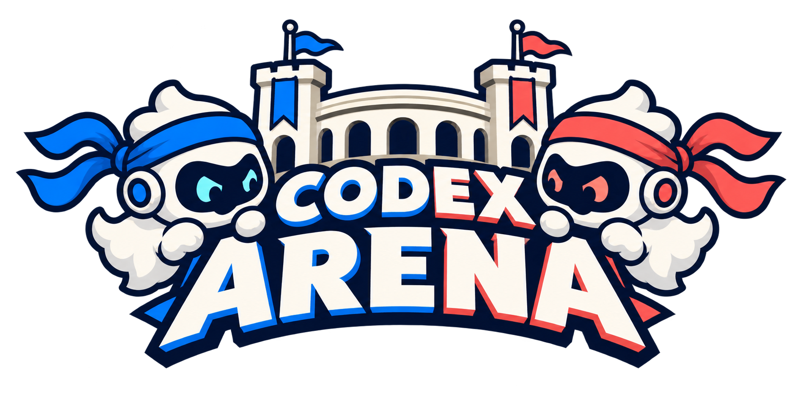
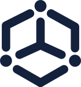

<div align="center">
  <a href="https://arena.aao.sh"></a>
</div>

<p align="center">
  <strong>Coloque estratégias à prova. Transforme as melhores em playbooks para o seu Codex.</strong>
</p>

<p align="center">
  <a href="https://github.com/AAO-SH/codex-arena"></a>
  <a href="https://github.com/AAO-SH/codex-arena/stargazers"></a>
  <a href="LICENSE"></a>
  <a href="https://github.com/AAO-SH/codex-arena/actions/workflows/tests.yml"></a>
  <br />
  <a href="https://www.npmjs.com/package/@aao-sh/codex-arena"></a>
  <a href="https://pypi.org/project/codex-arena/"></a>
  
  <br /><br />
  <a href="https://arena.aao.sh"></a>
  <a href="https://telegram.aao.sh"></a>
  <a href="https://discord.aao.sh"></a>
</p>

<hr />

**Seu agente pode aprender um jeito melhor de trabalhar.** Codex Arena compara estratégias em torneios e transforma os métodos vencedores em playbooks: guias práticos com automações que o Codex pode reutilizar no seu projeto. Antes de ativá-los, mede o resultado em tarefas inéditas.

## Por que usar

- **Encontre métodos que funcionam de novo.** Compare qualidade, tempo e consumo em tarefas recorrentes.
- **Leve o aprendizado para o próximo trabalho.** Reutilize instruções, scripts e verificações em playbooks.
- **Tenha controle do investimento.** Planeje a competição e defina limites antes de executar.
- **Mantenha o conhecimento no projeto.** Consulte memória local, evidências e histórico quando precisar.

## Comece pelo seu projeto

Abra a pasta em que você quer usar a Arena e peça ao Codex:

```text
Instale o Codex Arena neste workspace a partir de https://github.com/AAO-SH/codex-arena. Use --bootstrap, verifique o ambiente com doctor e mostre o plano antes de iniciar qualquer torneio.
```

A instalação é local ao projeto e não inicia uma competição. Você escolhe a pasta; não existe um caminho obrigatório.

<details>
<summary><strong>Prefere o terminal? npm, PyPI e instalação pelo GitHub</strong></summary>

Requer **Python 3.11+**. O npm é uma alternativa para chamar o instalador Python; também requer **Node.js 22+**. Execute os comandos dentro do workspace desejado. `--workspace .` significa “esta pasta”; você pode omitir essa opção ou informar qualquer caminho relativo ou absoluto entre aspas.

### npm

```bash
npx @aao-sh/codex-arena install --workspace . --bootstrap
```

### PyPI

Com [uv](https://docs.astral.sh/uv/), execute sem instalar o comando globalmente:

```bash
uvx --from codex-arena codex-arena install --workspace . --bootstrap
```

Ou instale o comando em um ambiente Python à sua escolha:

```bash
python -m pip install codex-arena
codex-arena install --workspace . --bootstrap
```

> Os comandos npm/PyPI exigem uma versão publicada nos registros. Se ela ainda não estiver listada, use a instalação pelo GitHub abaixo. Os badges exibem os dados informados pelos registros; pacotes novos podem levar algum tempo para apresentar estatísticas.

### Pelo GitHub

Na pasta em que você deseja manter o código da Arena:

```bash
git clone https://github.com/AAO-SH/codex-arena.git
cd codex-arena
```

Execute o instalador indicando **a pasta do seu projeto**, que pode estar em qualquer lugar:

```bash
python scripts/arena.py install --workspace "../seu-workspace" --bootstrap
```

O caminho acima é apenas um exemplo relativo. O instalador cria o destino quando necessário, copia a skill para `.agents/skills/codex-arena`, preserva a configuração existente e acrescenta seu bloco a `.codex/config.toml`. `--bootstrap` prepara `.venv` com as dependências fixadas.

### Verificar a instalação

Abra o terminal na pasta do projeto instalado.

**Windows / PowerShell:**

```powershell
.venv/Scripts/python.exe .agents/skills/codex-arena/scripts/arena.py doctor --json
.venv/Scripts/python.exe .agents/skills/codex-arena/scripts/arena.py plan
```

**Linux / macOS:**

```bash
.venv/bin/python .agents/skills/codex-arena/scripts/arena.py doctor --json
.venv/bin/python .agents/skills/codex-arena/scripts/arena.py plan
```

Para desfazer a instalação, execute o instalador do clone ou do pacote com `install --rollback --workspace "caminho/do/workspace"`. Consulte [instalação e recuperação](references/execution.md) e [distribuição npm/PyPI](references/packaging.md).

</details>

## Da competição ao playbook

**Compare → aprenda → valide → reutilize.** Escolha uma família de tarefas, coloque diferentes abordagens à prova e leve os métodos aprovados para o trabalho diário.

<details>
<summary><strong>Comparar estratégias, modelos e esforços</strong></summary>

O torneio tem três etapas e uma validação adicional:

| Etapa | O que acontece |
|---|---|
| Battle Royal | Todos se enfrentam; a pontuação organiza os participantes em tiers. |
| Swiss | Cada tier disputa vagas para a fase final. |
| Eliminação dupla | Séries de dez jogos definem o campeão de cada tier, com repescagem. |
| Validação “+1” | Cada playbook é comparado à execução sem playbook em casos inéditos. |

Os quatro tiers são **iron, copper, silver e gold**. A Arena distingue falha na tarefa, derrota por qualidade e empate. Modelos e esforços precisam ser compatíveis com o catálogo do ambiente; a política fica congelada durante a campanha. [Regras, rubrica e pontuação →](references/competition.md)

Use a Arena para tarefas recorrentes com critérios observáveis, como validar contratos JSON ou comparar fluxos de desenvolvimento com testes objetivos. Uma tarefa simples e única, sem critérios ou sem casos reservados, raramente justifica um torneio.

</details>

<details>
<summary><strong>Experimentar com uma demonstração, sem inferência paga</strong></summary>

No clone do repositório, prepare o ambiente:

```bash
python -m venv .venv
```

Ative-o com `.venv\Scripts\Activate.ps1` no PowerShell ou `source .venv/bin/activate` no Linux/macOS. Depois:

```bash
python -m pip install -r requirements.txt -c constraints.txt
python scripts/arena.py run --simulate --config examples/rules-smoke.json --cases examples/demo-suite.json --max-tokens 250000 --max-ms 180000
python scripts/arena.py status RUN_ID
python scripts/arena.py report RUN_ID --output relatorio.json
python scripts/arena.py playbook build --demo --name json-contract-demo
python scripts/arena.py playbook verify json-contract-demo
```

Troque `RUN_ID` pelo identificador retornado na execução. Os exemplos públicos demonstram os contratos; **simulação não mede qualidade real nem autoriza ativação de playbooks**. [Evidências de verificação →](references/verification.md)

</details>

<details>
<summary><strong>Planejar uma campanha real e ativar um playbook</strong></summary>

1. Copie [`assets/default-config.json`](assets/default-config.json) e ajuste regras, políticas, critérios e preços.
2. Prepare ao menos cinco casos de competição (`split: train`) e cinco reservados (`split: holdout`), conforme o [schema de casos](schemas/cases.schema.json). Mantenha os casos inéditos fora de prompts, memória, plugins e índices.
3. Execute `doctor --json`, `models` e `plan --config regras.json` para verificar capacidades e estimar o trabalho.
4. Inicie com `run --config regras.json --cases suite.json --max-tokens N --max-ms N`, substituindo `N` pelos limites autorizados.
5. Acompanhe com `status` e `report`. `resume` recebe limites **totais**; chamadas com conclusão incerta exigem conciliação antes de qualquer decisão de reexecução.
6. Com a campanha completa e campeões nos quatro tiers, use `playbook build --from-run RUN_ID --name nome --max-tokens N --max-ms N`.
7. Valide o candidato congelado com `playbook validate nome --cases holdouts.json --tier all --max-tokens N --max-ms N`. Ative apenas tiers aprovados: `playbook activate nome --tier gold`. Consulte suas instruções com `playbook show nome`.

A validação exige ao menos cinco casos inéditos e três repetições por caso e variante. O padrão de 100 competidores envolve **4.950 confrontos só no Battle Royal**; consulte o plano e dimensione a campanha antes de executá-la.

Campanhas reais requerem Codex CLI autenticado e um backend de sandbox que aplique leitura restrita. O sandbox Windows legado pode não atender a esse requisito; nesses ambientes, a Arena bloqueia o despacho. Consulte os [requisitos de execução](references/execution.md) para usar um backend compatível.

Os limites locais controlam reservas e duração acumulada; não garantem o valor final faturado pelo provedor. Custos calculados com preços de API são estimativas equivalentes. [Playbooks, validação e plugins →](references/playbooks.md)

</details>

<details>
<summary><strong>Memória, plugins, comandos e arquivos do projeto</strong></summary>

Recupere conhecimento com busca híbrida local e fontes identificadas. Plugins acrescentam comportamentos após verificação de compatibilidade. Documentos de conhecimento e playbooks seguem **OKF 0.2**; este README de apresentação não exige frontmatter.

| Comandos | Finalidade |
|---|---|
| `install`, `doctor`, `models`, `plan` | Instalação, diagnóstico, catálogo e planejamento |
| `run`, `resume`, `status`, `report`, `reconcile` | Execução, acompanhamento e recuperação |
| `playbook build/validate/activate/verify/show` | Geração e consumo de playbooks |
| `plugin check/enable/disable` | Composição de comportamentos |
| `memory download/index/search/graph` | Embeddings, busca e conhecimento local |
| `keys rotate/revoke` | Chaves e confiança |

Use `python scripts/arena.py --help` no clone. No projeto instalado, use o Python de `.venv` com `.agents/skills/codex-arena/scripts/arena.py`.

| Pasta no workspace | Conteúdo |
|---|---|
| `.agents/skills/codex-arena` | Skill instalada |
| `.codex/arena` | Chaves, aprovações e cache de embeddings |
| `.docs` | Documentos e grafo de conhecimento |
| `.memory/arena` | Estado e índices locais |
| `.scratch/arena` | Execuções, debates e candidatos |
| `.playbooks/<nome>` | Playbooks e evidências |

[Memória e recuperação →](references/memory.md) · [Arquitetura e contratos →](references/architecture.md)

</details>

<details>
<summary><strong>Desenvolvimento, testes e publicação de pacotes</strong></summary>

No clone, com o ambiente Python ativado:

```bash
python -m pip install -r requirements-dev.txt -r requirements-publish.txt
python -m pytest -q
```

Os testes de distribuição também requerem Node.js 22+. A suíte usa um executor simulado e não dispara torneios pagos. A CI cobre Windows, Linux e macOS com Python 3.11 e 3.12. Consulte [as evidências e os limites da verificação](references/verification.md) e [como construir e publicar os pacotes](references/packaging.md).

</details>

## Comunidade e agradecimentos

Uma iniciativa da [AAO.sh](https://aao.sh). Compartilhe ideias e experiências no [Telegram](https://telegram.aao.sh) e no [Discord](https://discord.aao.sh), ou contribua pelo [GitHub](https://github.com/AAO-SH/codex-arena).

Inspirado na [Arena de Jake Schincariol](https://github.com/Jakeschincariol/arena-skill/tree/df07b8e518e10cdecd8cd7712d9958b6f396250e), com atribuição MIT preservada. Apresentação alinhada ao [Fable Harness](https://github.com/AAO-SH/fable-harness). [Créditos completos](NOTICE.md) · [Fontes técnicas](references/sources.md).

<br />

<p align="center">
  <a href="https://aao.sh">
    <picture>
      <source media="(prefers-color-scheme: dark)" srcset="assets/aao-logo.svg" />
      
    </picture>
  </a>
  <br />
  Desenvolvido e mantido pela <a href="https://github.com/AAO-SH/codex-arena/graphs/contributors">comunidade AAO.sh</a>.<br />
  <a href="https://arena.aao.sh">arena.aao.sh</a> · <a href="LICENSE">Licença MIT</a>
</p>
